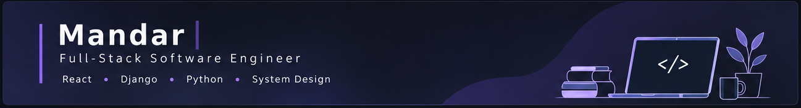

  

<h1 align="center">Hi, I'm Mandar 👋</h1>

  <strong>Full-Stack Software Engineer</strong> 
  React · React Native · Python · Django · PostgreSQL

  I build user-focused applications, develop backend APIs, and enjoy solving practical engineering problems.

---

## About me

- Currently working across full-stack application development and multi-tenant systems.
- Building interfaces with React and React Native, and backend services with Python and Django.
- Interested in backend architecture, API design, authorization, database design, and application performance.
- Currently strengthening my knowledge of system design, scalable architecture, and DevOps.

## Tech stack

**Languages**  

**Frontend & mobile**  

**Backend, databases & infrastructure**  

**Tools**  

## Featured projects

| Project | Description | Stack |
|---|---|---|
| [Chemical Product Inventory](https://github.com/Mandar-6/Chemical_Product_Inventory) | Full-stack chemical product management and inventory application. | React · Node.js · MySQL |
| [Playlist Manager](https://github.com/Mandar-6/Playlist-Manager) | Spotify-inspired playlist manager with custom features. | HTML · CSS · JavaScript |
| [React Login / Signup](https://github.com/Mandar-6/React-based-login-signup-page) | Login and signup interface built with React Router. | React · JavaScript |
| [Mini Project 006](https://github.com/Mandar-6/Mini-Project-006) | Python project. See the repository for implementation details. | Python |
| [Jenkinsfile](https://github.com/Mandar-6/Jenkinsfile) | Jenkins pipeline configuration. | Jenkins · CI/CD |

> **Current work:** ChemFlo CRM — a multi-tenant CRM involving Django APIs, PostgreSQL, and a React Native mobile application. Add a link here when its repository is public.

## GitHub stats

  
  

  

## Currently learning

- System design and scalable backend architecture
- API performance, database design, and application security
- Docker, Jenkins, and CI/CD workflows

## Connect

  <a href="https://github.com/Mandar-6">GitHub</a> ·
  <a href="https://www.linkedin.com/in/mandar-mandavgane">LinkedIn</a>

---

<em>Building, learning, and improving one commit at a time.</em> 🚀

